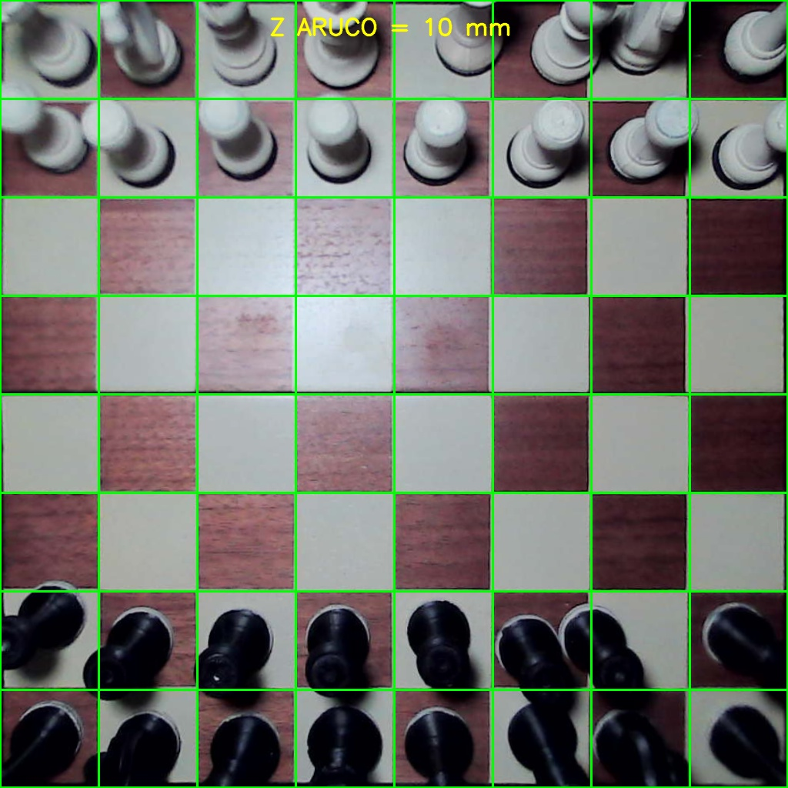

# Brokie — prototipo de robot de ajedrez

Brokie es un prototipo experimental de robot de ajedrez desarrollado alrededor
de una Raspberry Pi 5. Combina visión artificial, control de un brazo
articulado, interacción táctil y un motor de ajedrez para jugar sobre un
tablero físico real.

Este repositorio es una **presentación pública del proyecto**. No contiene el
código fuente, las calibraciones, los modelos de fabricación ni los parámetros
necesarios para reproducir el sistema.



*Vista canónica utilizada por el sistema para observar el tablero de manera
geométricamente estable.*

## Qué hace Brokie

- Observa el tablero con una única cámara.
- Detecta cuándo el jugador terminó de mover.
- Determina la transición realizada sobre el tablero físico.
- Mantiene el estado completo de la partida y valida sus reglas.
- Calcula una respuesta mediante un motor de ajedrez.
- Mueve físicamente sus piezas con un brazo y un electroimán.
- Gestiona capturas, enroques, promociones y jugadas inválidas.
- Informa estados y solicitudes de intervención desde una pantalla táctil.

## Video de demostración

[Ver “Un poco de cómo funciona Brokie”](media/un_poco_como%20_funciona.mp4)

El video muestra una demostración general del prototipo en funcionamiento. Se
publica como material audiovisual y no incluye los archivos internos necesarios
para reproducir el sistema.

## Enfoque general de visión

La cámara se encuentra integrada al conjunto móvil, por lo que la observación
se realiza desde una posición de referencia estable. El sistema corrige la
deformación óptica, usa marcadores visuales para normalizar el tablero y genera
una vista geométricamente consistente de sus 64 casillas.

La detección no depende de identificar visualmente cada tipo de pieza en una
fotografía aislada. Brokie compara el estado anterior y posterior del tablero,
analiza la persistencia temporal del cambio y combina esa evidencia con el
estado de la partida.

Las piezas incorporan aros de contraste en sus bases. Los aros claros sobre
piezas oscuras y oscuros sobre piezas claras proporcionan una firma geométrica
uniforme para confirmar ocupación sin alterar la forma tradicional del juego.
Esto mejora la robustez frente a vetas del tablero, sombras, reflejos y ligeros
descentramientos de las piezas.

## Flujo funcional

```text
jugada del usuario
  → observación y estabilización del tablero
  → detección de la transición física
  → validación de reglas
  → cálculo de la respuesta
  → ejecución mecánica
  → regreso a la posición de observación
  → nueva referencia para el siguiente turno
```

Durante el movimiento físico se suspenden las mediciones visuales y
ambientales. Una vez que el brazo regresa y el sistema se estabiliza, comienza
el siguiente ciclo de observación.

## Componentes generales

- Raspberry Pi 5.
- Cámara USB.
- Brazo articulado de cuatro ejes.
- Servos seriales.
- Electroimán como efector final.
- Sensor ambiental de iluminación.
- Pantalla táctil e interfaz web.
- Motor de ajedrez Stockfish.

## Estado del prototipo

Brokie se encuentra en desarrollo y validación sobre una unidad física única.
La precisión depende de su construcción, calibración, iluminación, piezas y
tablero. Los resultados observados en este prototipo no constituyen una
especificación comercial ni una garantía aplicable a otras construcciones.

## Contenido no publicado

Para proteger el desarrollo, este repositorio no distribuye:

- código fuente de visión, movimiento o control;
- calibraciones de cámara, tablero o brazo;
- parámetros, umbrales y casos de regresión;
- bitácoras y capturas técnicas de diagnóstico;
- diagramas eléctricos o instrucciones de fabricación;
- STL, 3MF u otros modelos tridimensionales;
- historial técnico interno del prototipo.

## Derechos

Copyright © 2026 Rodrigo Sebastián Siga. Todos los derechos reservados.

La publicación permite consultar esta presentación. No concede autorización
para reproducir, fabricar, adaptar, redistribuir ni explotar comercialmente el
proyecto o sus elementos. Consultar [COPYRIGHT.md](COPYRIGHT.md).
